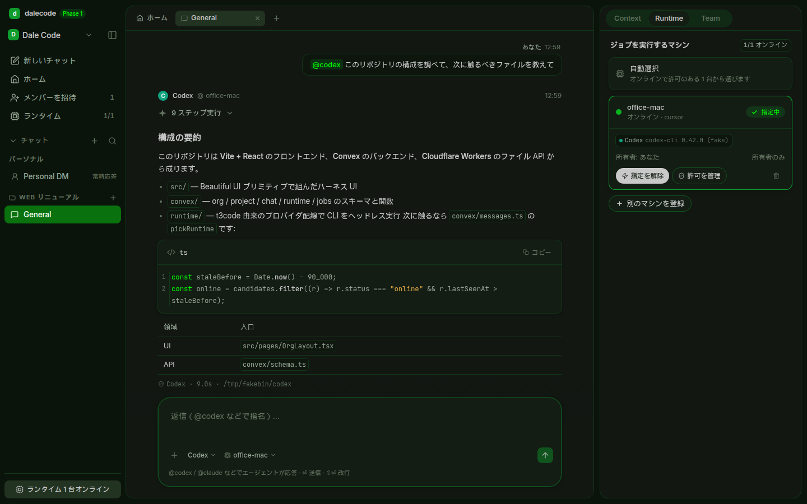
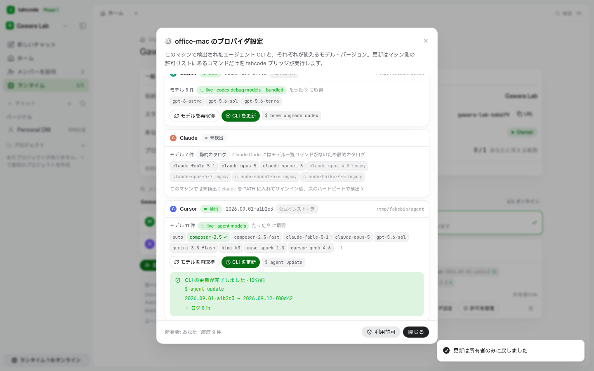

# tahcode — Phase 1

**tahcode**（ターコード、_team agent harness_）は、チームの会話と手元のマシンで動くコーディングエージェントをひとつの作業場にまとめる Web アプリ。本番: https://tahcode.com（Worker hostname `tahcode.gawara.workers.dev` は残す。旧称 **dalecode** から改名。npm パッケージ `dalecode` → `tahcode`、Worker `team-harness` → `tahcode`）。Multica の Org / member / project / chat の考え方を**設計の着想**として新スタックで実装した、最小チームチャット + オンマシン・コーディングエージェント（フォークでもランタイム依存でもない）。Phase 1 の垂直スライス: Org / Project 作成、Personal DM + プロ젝트チャット、メンション応答、履歴 + メンション + プロジェクトリンクのコンテキスト、t3code 由来プロバイダのマシンランタイム、最小ロール + ランタイム許可。Convex（データ/リアルタイム）+ Cloudflare（ホスティング/ファイル）。

UI は [Beautiful UI](https://www.beautifului.dev/) のプリミティブと [/harness](https://www.beautifului.dev/harness) のシェル構成をそのまま採用（shadcn レジストリ経由で導入）し、配色は VS Code **Dark Green+**（kazelone.vscode-dark-green-plus）をトークンにマッピング。ライトが既定（ダークはトグルで切替、選択は localStorage に保存）。プロバイダ配線は https://github.com/pingdotgg/t3code の `builtInDrivers.ts` （Codex / Claude / Cursor / Grok / OpenCode / Antigravity の6種）を移植。Multica からは Org / member / project / chat の考え方と作成フローの型だけ借りた新規実装（フォークではない。daemon / CLI は使わない）。



## Scope（Phase 1）

- ✅ Org → Project 階層、プロジェクト可視性（org / private）+ プライベートチャットの per-chat 追加
- ✅ Personal DM（Phase 1 は owner-only）+ プロジェクトチャット
- ✅ エージェント応答: DM は常時、他は @mention（@agent / @codex / @claude / @cursor / @grok / @opencode / @antigravity / @rt-…）時のみ
  - メンションは `@provider/model` の形でモデルまで指名できる（例 `@cursor/muse-spark-1.3`、`@claude/opus`）。`@cursor` だけなら Cursor CLI の既定モデル（従来どおり）。詳細は [プロバイダとモデル](#プロバイダとモデルproviderモデル)
  - 仕様: チャットはエージェント（プロバイダ + モデル）に結びつけて作成でき、プロジェクトチャットでメンションなしで送信すると Composer がそのメンション（例 `@cursor/muse-spark-1.3`）を自動付与してから送る。DM はメンションなしでもチャットのエージェントで動く。サーバ側ルール自体はメンション必須のまま（`convex/messages.ts`）。素のメッセージを送りたい場合は現状 UI からは不可（Phase 1 の簡略化）
- ✅ コンテキスト = 直近履歴 + メンション + プロジェクトリンク（Focus なし）
- ✅ マシンランタイム（t3code 由来の headless CLI 実行）+ default deny のランタイム ACL（user / role 混在可）
- ✅ ロール: owner（全体）/ admin（招待 + 権限）/ member（見える範囲のみ）
- 🚫 対象外: Kanban/Issue、Focus モード、Codex Cloud / Cursor Cloud Agent、DM の後から共有 UI、Linear 連携、Cloudflare 上でのエージェント実行

## UI — Beautiful UI × Dark Green+

### 導入方法（shadcn レジストリ）

Beautiful UI は npm パッケージではなく **shadcn 互換のコンポーネントレジストリ**（`https://www.beautifului.dev/r/registry.json`）。 `components.json` に `@beautifui` 名前空間を登録済みで、プリミティブは次で追加・更新する:

```bash
npx shadcn@latest add @beautifui/thinking-state   # 例。foundation は registryDependencies で自動解決
```

インストール先は `src/components/atoms/*`（Button, EntityChip, ValuePill, Chip, StatusPill, SegmentedControl, TextRow）と `src/components/primitives/*`。`src/app/beautifui/foundation.css` がトークン（`:root` / `.dark` / `@theme`）・基本ルール・共有キーフレーム、`sidebar-nav.css` が SidebarNav の開閉演出。`shadow-plugin` は foundation が要求する依存。

### 採用したプリミティブと使い所

| プリミティブ | 使い所 |
| --- | --- |
| **SidebarNav**（移植: lucide アイコン、データ駆動化） | ワークスペース切替（Org）、新しいチャット / ホーム / 招待 / コネクタのレール、Projects→Chats ツリー、52↔224px 折りたたみ。設定は左下ユーザーメニュー |
| **PromptBar**（移植: デモ/口述/シェーダを除去、データ駆動化） | コンポーザ。`@` でエージェント + メンバー、`/` でコマンド、プロバイダ / ランタイムのピルピッカー、R2 添付チップ、⏎送信 / ⇧⏎改行、IME 対応 |
| **ThinkingState**（`working` prop を追加してライブ駆動） | ランタイムの `thinking` イベントをそのままトレース行に。実行中はシマー + スピナー、完了で「N ステップ実行」に畳む |
| **ToolChips**（`live` / `fill` prop を追加） | ランタイムの `tool` イベント（コマンド実行・編集・MCP）を展開可能なチップ行に。「N 件のツール呼び出し」で畳む |
| **Search**（データ駆動化 + ↑↓⏎） | ⌘K / Ctrl+K のコマンドパレット。チャット・プロジェクト・作成/登録/招待/設定を横断検索 |
| **StreamingText** のアクション行 / フォローアップ | 返信下のコピー・再実行アイコン、最新の返信に続く「続けて聞く」候補（クリックで送信） |
| **Shimmer** | 「読み込んでいます」「CLI を検出しています」など進行中ラベル |
| **LoadingState** | ジョブ受付待ち・接続待ち・画面ロード（ピクセルグリッド + 経過秒） |
| **CodeBlock** | 返信内のコードフェンス、ランタイム起動コマンド（コピー付き） |
| **ContextCards** | Context タブ「エージェントに渡すもの」（project link / 履歴 / メンション） |
| **TaskRows**（静的 `queued` / `failed` を追加） | Context タブ「実行履歴」（チャットごとのジョブ状態） |
| **GlideMenu** | すべてのメニュー / 選択肢の滑るホバー（ワークスペースメニュー、ロールメニュー、ダイアログの選択肢） |
| Button / StatusPill / ValuePill / Chip / SegmentedControl / TextRow / EntityChip(Monogram) | ボタン、ロール・状態ピル、件数、ハンドル、タブ切替、設定行、アバター |
| ハーネスの構成（`IceCreamHarness`） | 3 ペインシェル、チャットタブバー、ホームの登場ストーリーボード（blur → 定位置）、ユーザーバブル、返信の fade-up、浮かぶコンポーザと追従スクロール |

見送り（Phase 1 に対応する機能がないため未導入）: ApprovalCard（承認フローは Phase 1 外）、DiffTable / ToolChips の diff チップ（構造化 diff をランタイムが返さない）、RecordsTable / FilterTable / InsightCards / Flowchart / FineTuneCard / SelectionActions / RecommendationCard / ChatComposer(デモ)。

### テーマ（`src/app/theme.css`）

Dark Green+ の生トークンを `--dg-*` として保持し、Beautiful UI のセマンティックトークンに解決する:

| Dark Green+ | 値 | → Beautiful UI |
| --- | --- | --- |
| editor.background | `#121712` | `--page`（メインペイン） |
| sideBar.background | `#0b140b` | `--canvas`（シェル / サイドバー） |
| panel.background | `#141d14` | `--surface`（カード / メニュー） |
| activityBar / titleBar | `#040f04` / `#020f02` | `--stripe-bg` / `--tooltip-bg` |
| accent | `#0e9c2d` | `--accent`（リング / フォーカス / 強調塗り） |
| accent bright | `#00ff00` | `--accent-ink`, `--caret`（ストリーミングカーソル、小さな強調のみ） |
| button.background / hover | `#077015` / `#0ab320` | `--btn` / `--btn-hover`（Button `accent`、送信ボタン） |
| foreground | `#c9c9c9` | `--ink` |
| border | `#0e9c2dcc` | `--line` / `--line-strong`（同じ色相を減光したヘアライン、フォーカスで強く） |
| selection | `#196626` | `::selection` |
| list.activeSelectionBackground | `#09710e` | `--active`（サイドバーのアクティブ行） |

ライトテーマはワークスペースメニューから切替（Beautiful UI の寒色ニュートラル + 同じ緑アクセント）。

### ジャーニー（すべて空 → 作成 → 成功で次の一手を提示）

1. **Auth** — `/login`（ログイン / 新規登録の切替）。メール＋パスワード、または **Google で続ける**（OAuth 設定時のみ有効）。`?next=` で招待リンクへ戻る（Google 経由でも維持）。入力検証と失敗メッセージは日本語（空欄・形式不正・8 文字未満・確認不一致・パスワード相違・登録済みメール・ネットワーク断・セッション未確立）。サインアウトはワークスペースメニュー
2. **First run** — Org がなければ `/welcome`。Org 作成（Owner になる）または招待トークンで参加 → 作成後は Personal DM が即使えるホームへ
3. **Org 切替 / 設定** — サイドバー上部のワークスペースメニュー（切替・新規・設定・コネクタ・招待・テーマ・サインアウト）、`/o/:slug/settings`。コネクタは専用面 `/o/:slug/connectors`（Org 設定の一節ではない）
4. **プロジェクト作成** — プロジェクト作成ダイアログ（名前、公開範囲 org / private、任意でリポジトリ URL と作業ディレクトリ。作成フローの型は Multica を着想にした）。作成すると「General」チャットが開く
5. **チャット作成 / 開く** — 「新しいチャット」ダイアログ（場所 = プロジェクト or Personal DM、タイトル、公開範囲、エージェント = プロバイダ + モデル + 推論レベル）。選んだエージェントはチャットに保存され、最初の 1 通から自動メンション（`@cursor/muse-spark-1.3`）に使われる。開いたチャットは上部タブに並ぶ
6. **招待とロール** — Team タブ / 「メンバーを招待」（Admin 以上）。招待リンク `…/invite/<token>` を発行 → 受け取った人はサインイン後 `/invite/:token` で参加。ロール変更は Owner / Admin（Owner の付与は Owner のみ、最後の Owner は降格不可）
7. **ランタイム登録** — ブラウザは「このマシンを登録」→ 一度きりのトークン入りの `npm i -g tahcode` / `tahcode link` / `tahcode start`。デスクトップシェルでは「この Mac を登録」ワンクリック（main が同じ CLI を実行）。最初のハートビートで同じ画面が「接続されました + 検出した CLI」に変わる
8. **利用許可（default deny）** — 「許可を管理」ダイアログ。メンバー単位 / ロール単位を混在して付与・取消。所有者以外は許可があるまで「利用許可がありません」の説明付き **プロバイダ設定** — マシンカードの「プロバイダ設定」で、検出 CLI ごとの使えるモデル（ライブ / 静的）・バージョン・インストール方法を確認し、所有者は「CLI を更新」「モデルを再取得」を実行（進行ログ・結果はその場に表示）
9. **チャット** — 返信はジョブ受付待ち → トレース → ストリーミング Markdown → CodeBlock / 表。`@` ピッカー（`@cursor/` と打つとそのプロバイダのモデル候補）、プロバイダ / モデル / 推論レベル / ランタイムピッカー（変更はチャットに保存）、プロジェクトリンクは Context タブ
10. **右レール** — Context（渡すもの・実行履歴・参加メンバー） / Runtime（マシンと許可、使用マシンの指定） / Team（名簿とロール） **⌘K** — コマンドパレットからチャット・プロジェクト・各操作へ
11. **権限の行き止まり** — Member には「招待」が無効表示 + 理由、使えるマシンがなければコンポーザ上に理由と次の一手、見えないチャットは説明付きの空状態

スクリーンショット一覧: `docs/ui-screenshots/`（01 → 43 の順で上のジャーニーをなぞる。`localhost` のフェイク `codex` CLI で実際にジョブを流したもの）。プロバイダ + モデルの結びつけと `@provider/model` メンションは `docs/ui-screenshots/agent-model/`（引数をそのまま返すフェイク CLI で `--model` が届くことを確認）。

### プロバイダとモデル（`@provider/model`）

- **カタログ** — `shared/providers.ts` が 6 プロバイダごとのモデル一覧を持つ。出典は t3code の `model-manifest.json`（Codex / Claude / Antigravity）、Multica の `models.go` 静的カタログ（Codex / Claude / Grok）、Cursor のモデルドキュメント（Cursor CLI の id）。Cursor / Grok / OpenCode は上流ではサインイン済み CLI から動的に取得するため、ここでの一覧はスナップショット。**一覧にないスラッグも `@cursor/<slug>` で直接指名でき、そのまま CLI に渡る**（CLI 側のカタログが正）。
- **メンション文法** — `@provider/model`。最初の `/` で分割するので OpenCode の `@opencode/anthropic/claude-sonnet-5` も通る。Claude の別名（`@claude/opus` → `claude-opus-5`）はカタログで解決。`@agent` は「このチャットのエージェント」。
- **既定モデル（後方互換）** — `@cursor` のようにプロバイダだけの指名は、そのプロバイダの既定モデル = **CLI 側の設定に従う**（`--model` を付けない）。これまでの `@codex` / `@claude` はそのまま同じ動きをする。チャットが `cursor/muse-spark-1.3` に結びついているときは素の `@cursor` もそのモデルで動く（別プロバイダを素で指名したときはその CLI の既定）。
- **チャットへの結びつけ** — `chats.driverKind` / `chats.model` / `chats.options`。「新しいチャット」ダイアログで選ぶか、コンポーザのプロバイダ / モデル / 推論ピッカーで変更（`chats:setAgent`、チャットのメンバー全員に共有）。優先順位は **明示メンション > コンポーザ / チャットの結びつけ > ランタイムに入っている CLI**。別プロバイダを `@mention` したときはそのプロバイダの CLI 既定に戻り、effort も引き継がない。
- **ランタイム** — ジョブが `model` を持つときだけ CLI にフラグを付ける: `codex exec --model`、`claude -p --model`、`agent -p --model`、`opencode run --model provider/model`、`grok --model`（Grok の headless 引数は暫定のまま）。指名されたプロバイダの CLI がそのマシンに無いときは別の CLI で黙って実行せず、「未インストール」を返信として返す。サーバ側も指名プロバイダが検出済みのマシンを優先して選ぶ。`tahcode start --provider <kind>` で固定した場合はメンションのモデル指定は無視される（モデル名はプロバイダ固有のため）。認証 UX の検証ショット（ログイン / 新規登録 / 各バリデーション / エラー状態 / モバイル、デスクトップ＋390px）は `docs/ui-screenshots/auth/`。

### 推論レベル（effort / reasoning）

t3code の `TraitsPicker` + `ProviderOptionDescriptor` を、tahcode の既存エージェント結びつけ（チャット保存 → job → `headlessArgs`）に載せたもの。コンポーザと「新しいチャット」に **descriptor ごとの SELECT / On-Off ピル** が出る（対応プロバイダだけ。Antigravity はモデル slug に High/Medium/Low が含まれるので非表示）。ラベル・値・既定は t3code に合わせてある。

| プロバイダ | option id | 既定 | 実行時 |
| --- | --- | --- | --- |
| Codex | `reasoningEffort`（None…Ultra、`xhigh` = Extra High）+ `serviceTier`（Standard / Fast） | Reasoning `medium`（`gpt-6-astra` も medium。ライブ `codex debug models` に `supported_reasoning_levels` があればそれを使う）。Service Tier `standard` | `codex exec --config model_reasoning_effort=high` · `--config service_tier=fast`（未選択ならフラグなし = CLI の設定） |
| Claude | `effort`（Low…Max / Ultracode / Ultrathink）。Haiku は `thinking` On/Off。Opus 系は `fastMode`。Fable / Opus 5 / Sonnet は `contextWindow`（200k / 1M） | Fable `medium`、Opus/Sonnet `high`、Opus 4.7 `xhigh`。Fast Mode Off。Context Window は Fable/Opus 5 が 1M、Sonnet が 200k | `claude -p --effort …`。Ultrathink はプロンプト先頭 `Ultrathink:\n`（`--effort` なし）。Ultracode は `--effort xhigh` + `--settings {"ultracode":true}`。Fast Mode は `--settings {"fastMode":true}`。1M は `--model {slug}[1m]`。モデルごとの `effortMap`（Opus 4.7 の `xhigh`→`max`、Sonnet 4.6 の `max`→`high`）も t3code と同じ |
| OpenCode | `variant`（low / medium / high / xhigh）+ `agent`（Build / Plan） | Anthropic/Google `high`、OpenAI `medium`。Agent `build` | `opencode run --variant high` · `--agent plan` |
| Cursor | `reasoning`（ライブカタログの suffix。未取得時は low…xhigh） | `medium` | `agent --model {family}-{effort}`（例 `cursor-grok-4.6-medium`）。モデル一覧は家族のみ。`@cursor` だけなら `--model` なし |
| Grok | `reasoningEffort` | `high` | **保存のみ。** headless `grok --prompt` のフラグは未確定（t3code は ACP） |
| Antigravity | （なし） | — | モデル slug で切り替え |

**t3code との差（意図的な簡略化）**

- Composer / AgentPicker は `optionDescriptorsFor` の全 descriptor を SELECT / On-Off ピルで出す（t3code TraitsPicker の 1 メニューではなく PromptBar パターン）。`fastMode` / `serviceTier` / `contextWindow` / OpenCode `agent` は明示選択時だけ CLI フラグになる。
- Ultrathink はチャットの `options` に保存する（t3code Web はプロンプト注入だけで option には残さない）。本文に `ultrathink` があれば二重付与しない。スラッシュコマンドは注入しない。
- Grok の選択はチャットに残るが headless 実行には乗らない（上記）。Cursor は family + effort を `--model` に合成する。
- モバイル専用の `selectableChoices`（ultrathink / ultracode を隠す）は Web のみの tahcode には無い。

選択は `chats.options` / `jobs.options` の `{ id, value }[]`（t3code の `ModelSelection.options`）。未選択の既存チャットは従来どおり CLI 側の effort 設定に従う。

### マシンのプロバイダ設定（モデル・バージョン・CLI 更新）

マシン単位の設定画面。tahcode ブリッジが CLI を検出してバージョンを報告し、モデル一覧は各 CLI から動的に取得して静的カタログにフォールバックする。右レール Runtime タブ / Org 設定のマシンカードの **「プロバイダ設定」**（または CLI チップのクリック）で開く。



- **見えるもの** — 6 プロバイダごとに: 検出状態・バージョン・インストール方法（npm / Homebrew / 公式インストーラ）・バイナリのパス、**使えるモデル一覧**（ライブか静的かのバッジ、取得時刻、失敗理由）、ブリッジが実行する更新コマンドのプレビュー（`$ agent update`）。チャットを作らなくても常に一覧が見える。
- **モデル一覧のライブ取得** — ブリッジ（`tahcode start`）が起動時と 30 分ごと、更新後・再取得指示後に各 CLI の一覧コマンドを叩き、ハートビートで報告する。コンポーザのモデルピッカー・`@cursor/` のメンション候補・「新しいチャット」のモデル選択も、接続中のマシンがライブ一覧を報告していればそれに差し替わる（フッターに `live: agent models の結果（office-mac）`）。Cursor のライブ ID（`cursor-grok-4.6-medium` など）は家族（`cursor-grok-4.6`）に畳み、エフォートは Reasoning セレクトで選ぶ。マシンが 1 台もなければ静的カタログ。

| プロバイダ | モデル一覧 | 更新コマンド（ブリッジの許可リスト） |
| --- | --- | --- |
| Codex | **live** `codex debug models --bundled`（0.122.0+、JSON。古い CLI は静的） | npm `npm i -g @openai/codex@latest` / Homebrew `brew upgrade codex` / 判別不能なら手動案内 |
| Cursor | **live** `agent models` | `agent update` |
| OpenCode | **live** `opencode models`（`provider/model`） | `opencode upgrade`（CLI 側がインストール方法を判別） |
| Grok | **live** `grok models` | npm 導入なら `npm i -g @xai-official/grok@latest`、それ以外 `grok update` |
| Claude | 静的（一覧コマンドなし） | npm `npm i -g @anthropic-ai/claude-code@latest` / Homebrew `brew upgrade claude-code` / それ以外 `claude update` |
| Antigravity | 静的 | なし（アプリ側で更新） |

- **更新の流れ** — 「CLI を更新」→ Convex の `runtimeCommands` に `(updateCli, provider)` がキューされる → ブリッジが claim し、**マシン側の許可リスト**からインストール方法に応じた argv を解決して shell なしで spawn → 出力をログとして流しつつ実行 → 終了後にバージョンを再検出（`0.9.0 → 0.9.1`）、モデル一覧も再取得。UI は待機中 / 実行中（ログの末尾）/ 完了 / 失敗（終了コードと最終行、ログ展開）を同じカード内に出す。サーバはコマンド文字列を送らないので、サーバが乗っ取られても許可リスト外は走らない。「モデルを再取得」は同じ経路で一覧コマンドだけを実行する。ブリッジが落ちて 15 分報告がない実行は自動で失敗扱い（取り消しも可）。
- **権限（default deny を維持）** — 「CLI を更新」は**マシンの所有者のみ**。所有者が設定画面の「Org の Owner / Admin にも CLI の更新を許可」をオンにした場合だけ Admin 以上も実行できる（既定オフ、`runtimes.maintenanceByAdmins`）。「モデルを再取得」は読み取り専用なので、そのマシンの利用許可を持つ人も実行できる。実行ログ（ローカルパスを含む）は更新権限のある人にだけ返す。閲覧（検出 CLI・モデル・バージョン）は Org メンバー全員。ルールは `shared/providerMaintenance.ts:canRequestMaintenance`（テスト付き）。
- **古いブリッジ** — 更新機能はブリッジが `capabilities: ["maintenance","liveModels"]` を報告したときだけ有効。旧バージョンには「`npm i -g tahcode@latest && tahcode restart`」の案内を出す。
- **CLI からも同じこと** — `tahcode models [provider]`（ライブ一覧 / 静的フォールバック）、`tahcode update <provider|all> [--yes]`（同じ許可リストのコマンドを表示 → `--yes` で実行）。

スクリーンショット: `docs/ui-screenshots/provider-settings/`（接続 → カードのモデル数 → 設定画面 → 更新の実行中 / 完了 / 失敗 → モデル再取得 → 権限トグル → 履歴 → ピッカーのライブ表示 → Member 視点の読み取り専用）。

## Stack

パッケージ名・Worker 名は `tahcode`（production `tahcode` → `tahcode.gawara.workers.dev`、staging `tahcode-staging`、preview `tahcode-preview`）。R2 バケット名 `team-harness-files*` はデータを保持しているため据え置き（改名にはバケット作成 + オブジェクト移行が必要。ユーザーには見えない）。 `HARNESS_*` 環境変数は CLI の互換フォールバックとして残す。ユーザーに見える名前はすべて **tahcode**。

- UI: Vite + React 19 + Tailwind v4 + Beautiful UI（shadcn レジストリ）+ Convex Auth（Password）+ react-router
- Data/realtime: Convex（`convex/`）。認証は Convex Auth Password。権限は custom function ラッパ + 共有アクセスロジック
- Hosting/files: Cloudflare（`worker/` + `wrangler.jsonc`、R2 バケット `FILES`）。ファイル本体は Worker（`/api/files`）経由で R2、メタデータは Convex `files`
- Providers: t3code の6ドライバを `shared/providers.ts`（カタログ）+ `runtime/src/providers.ts`（headless 実行）に移植
- Runtime: `tahcode` CLI（`packages/cli`）= Convex をポーリングする tahcode ブリッジ（`runtime/`）。headless CLI 起動は t3code 由来

## ローカルで動かす

前提: Node **22.18+**（Oxlint / Oxfmt の TypeScript 設定を読むため）、npm。

```bash
npm install --legacy-peer-deps

# 1) Convex（匿名エージェントモード。Convex アカウント不要）
CONVEX_AGENT_MODE=anonymous npx convex dev

# 1b) Convex Auth 用の鍵をローカル backend に登録（初回のみ）
npm run setup:local-auth

# 2) Web（別ターミナル）
npm run dev        # http://127.0.0.1:43173

# 3) ファイル Worker（別ターミナル、R2 ローカル永続化）
npm run dev:files  # http://127.0.0.1:43174（Vite が /api/files をプロキシ）
```

`.env.local` は `npx convex dev` が生成（`VITE_CONVEX_URL=http://127.0.0.1:3210`）。本番相当の確認: `npm run build` → `npm run preview:cf`（dist を Worker で配信）。

### マシンランタイム（`npm i -g tahcode`）

エージェントはあなたのマシンで、**tahcode ブリッジ**経由で動きます。`tahcode start` が Convex をポーリングし、検出したプロバイダ CLI を headless で起動します（`packages/cli`、npm パッケージ名 `tahcode`、bin `tahcode`）。

1. Web UI → 右レール **Runtime** タブ →「このマシンを登録」。ブラウザでは一度だけ表示されるトークン入りのコマンド 3 行が発行されます。デスクトップアプリ（`apps/desktop`）では **この Mac を登録** が一発で同じ手順を実行します（詳細は [`apps/desktop/README.md`](apps/desktop/README.md)）:

```bash
npm i -g tahcode
tahcode link --url "https://<deployment>.convex.cloud" --runtime "<id>" --token "th_…" --name "office-mac"
tahcode start        # tahcode ブリッジをバックグラウンドで常駐
```

2. エージェント CLI は 1 つ以上ログイン済みにする: `codex login` / `claude auth login` / `agent login` / `grok login` / `opencode auth login`
3. 確認: `tahcode doctor`（Node / 検出 CLI / tahcode 接続 / `tahcode tool`）、`tahcode status`、`tahcode logs -f`。モデル一覧: `tahcode models [provider]`、CLI の更新: `tahcode update <provider|all> --yes`（Web UI の「CLI を更新」と同じ許可リスト）。エージェントツール（`@linear` 含む）には **tahcode CLI 0.1.1+**。`npm i -g tahcode@0.1.1` のあと `tahcode restart`（`service install` は launchd 環境を消すので使わない）。

役割分担: tahcode バックエンドが Org・ランタイム・トークン・default deny の許可を持ち、 `tahcode start` のブリッジがチャットのジョブをローカルの CLI（t3code 由来の 6 プロバイダ）に流します。

リポジトリ内での開発: `npm run cli -- doctor`（tsx でソース実行）、`npm run cli:build`（`packages/cli/dist/tahcode.mjs` にバンドル）。公開手順は [`packages/cli/README.md`](packages/cli/README.md)。CI や 1 回限りの実行では環境変数 `TAHCODE_URL` / `TAHCODE_RUNTIME_ID` / `TAHCODE_TOKEN` でもリンクできます。

DM で話しかけると常時応答、プロジェクトチャットでは `@codex 直して` や `@cursor/muse-spark-1.3 直して` のようにメンションする。送信時にチャットのエージェントのメンションが自動付与される（プロジェクトのみ。DM は付与なしでチャットのエージェントで動く）。

## リポジトリ構成（着想: Multica 型モノレポ）

Web と Desktop を **1 つのモノレポ**に置き、共有パッケージ + 薄いシェルで構成する。[Multica](https://github.com/multica-ai/multica) の `apps/web` + `apps/desktop` + `packages/{core,ui,views}` と同じ考え方を**設計の着想**にしているだけで、Multica のコードも daemon も依存しない。パッケージマネージャは npm workspaces（`apps/*`, `packages/*`、lockfile はルートの 1 つ）。

| Multica | tahcode（現状） | 中身 |
| --- | --- | --- |
| `apps/web`（Next） | **ルート直下の Vite アプリ**（`src/`, `index.html`, `vite.config.ts`, `worker/`, `wrangler.jsonc`） | Web。Cloudflare の deploy 設定がルートを前提にしているため、この PR では動かしていない（後述） |
| `apps/desktop`（Electron + electron-vite） | [`apps/desktop`](apps/desktop) = `@tahcode/desktop` | Electron + electron-vite の**薄いシェル**。renderer をバンドルせず、デプロイ済み Web を URL で読む |
| `packages/core` | [`packages/core`](packages/core) = `@tahcode/core`（現在は `./desktop` のみ）+ `shared/` | フレームワーク非依存のロジック。`@tahcode/core/desktop` は deep link / OAuth リダイレクトの契約（Web・Convex・Desktop の 3 者が同じ TS ソースを取り込む）。`shared/`（mentions / access / auth / providers）は次の移設候補 |
| `packages/ui` / `packages/views` | `src/components` / `src/harness`（未分離） | Desktop が renderer をバンドルする段階になったら切り出す。今は Web 側からのみ参照されるため分離しない（重複を作らない） |
| `server`（Go）+ CLI | `convex/` + `runtime/` + [`packages/cli`](packages/cli)（`tahcode`） | バックエンドは Convex、ランタイムは tahcode ブリッジ + headless CLI |

Desktop が「Web を URL で読む」方式なのは、共有 UI の切り出しを **必要になった分だけ**に留めて Vite/React アプリを二重化しないため。Web に手を入れれば Desktop にも即反映され、Desktop 固有のコードは main / preload と `@tahcode/core/desktop` だけになる。 `apps/web` への物理的な移設（`src/` 一式 + `wrangler.jsonc` の `assets.directory` + `cf:build` + `tsconfig` の参照）は Cloudflare deploy に触るため、Web CI のリスクを切り離した別 PR で行う。

### デスクトップアプリ（macOS、Electron）

Google ログインはシステムブラウザで行い、`tahcode://auth/callback` の deep link で戻ってくる。設計・Electron を選んだ理由・署名/公証の手順は [`apps/desktop/README.md`](apps/desktop/README.md)。

```bash
npm install --legacy-peer-deps   # ルートで 1 回（workspaces が apps/desktop と packages/core も入れる。Electron 本体は初回起動時に取得）
npm run desktop:dev              # electron-vite dev。production の Web を読み込む（TAHCODE_DESKTOP_ENV=staging|local で切替）
npm run desktop:pack             # 未署名 .app（apps/desktop/release/mac-arm64/tahcode.app）— deep link の検証はこちら
npm run desktop:build            # Apple Silicon 向け .dmg / .zip（apps/desktop/release/）
```

Linux CI（`.github/workflows/desktop.yml`）は typecheck → `npm test` → `electron-vite build` → xvfb で起動 → スクリーンショット → `electron-builder --linux dir` まで、macOS の `.dmg` は `workflow_dispatch` / `desktop-v*` タグで `macos-latest` が作る（未署名）。`desktop-v*` タグは GitHub Releases にも載り、デスクトップの「アップデートを確認」がそれを見る。スクリーンショットは `docs/desktop-screenshots/`。詳細は [`apps/desktop/README.md`](apps/desktop/README.md) の「アップデート」。

## 受け入れ基準の対応

1. Org / Project 作成 → `/welcome` と ワークスペースメニュー（Org）、サイドバーの ＋ / `/project`（Project、org/private + リソース）
2. DM / プロジェクトチャット → DM は Org 参加時に自動作成、プロジェクトチャットは「新しいチャット」ダイアログ / プロジェクト行の ＋
3. DM 常時 / 他はメンション時のみ → `shared/mentions.ts`（`@provider/model` 文法）+ `convex/messages.ts:send`
4. Context = 履歴 + メンション + プロジェクトリンク → `convex/lib/context.ts`（ジョブに JSON 同梱、ランタイムがプロンプトに付与）
5. t3code 由来プロバイダで実行 → `tahcode start`（tahcode ブリッジ）→ `runtime/src/providers.ts`（6種カタログ、`codex exec` / `claude -p` / `agent -p` / `grok` / `opencode run`）
6. 最小ロール + ランタイム許可 → Org ロール + `runtimeGrants`（default deny、machine owner 付与）
7. Convex + Cloudflare → Convex が全データ/リアルタイム、Worker + R2 がホスティング/ファイル

## スタブ・既知の制限

- **Antigravity**: headless CLI がないためランタイムは「未対応」表示 + ガイド文。カタログには含む。
- **Grok headless flags**: CLI の headless 引数は暫定（`grok --prompt`、モデルは `--model`）。手元に CLI があれば `providers` コマンドで確認し、ずれていたら `runtime/src/providers.ts` の1箇所を直す。
- **Claude のモデル一覧は静的**: Claude Code にはモデル一覧コマンドがないため `shared/providers.ts` のスナップショット（t3code model-manifest）のまま。Codex / Cursor / Grok / OpenCode は接続中のマシンから `codex debug models --bundled` / `agent models` / `grok models` / `opencode models` の結果をライブ表示する（Codex 0.122.0 未満は静的にフォールバック）（[マシンのプロバイダ設定](#マシンのプロバイダ設定モデルバージョンcli-更新)）。一覧外のスラッグは引き続き `@provider/<slug>` でそのまま指名できる。
- **CLI 更新は許可リストのコマンドのみ**: `shared/providerMaintenance.ts` にある各 CLI の公式更新コマンドだけをブリッジが実行する。Antigravity（CLI なし）と、インストール方法を判別できない Codex は手動更新の案内のみ。`curl | sh` 型のインストーラは実行しない。
- **プロジェクトメンバー追加 UI なし**: private project への追加は現状 `projects:addMember` 関数呼び出し（`npx convex run` 等）。UI は Org メンバー招待・ロール・ランタイム許可まで。
- **Org 名変更 / 削除なし**: 設定ページは表示のみ（Owner 向けの変更は後続フェーズ）。
- **ファイル配信**: 各環境の R2 バインディング必須（`wrangler deploy` / `versions upload` 前にバケット作成。Wrangler はバケットを作らない）。本番 `team-harness-files`、staging `team-harness-files-staging`、preview `team-harness-files-preview`。ローカルは `wrangler dev` のローカル永続化。
- **ファイル Worker に認証なし**: `/api/files` は誰でも POST/GET 可能（メタデータ登録側の Convex は認証必須）。本番公開前に Worker 側で Convex トークン検証を足すこと。
- **Convex デプロイ**: ローカルは匿名モード。本番 Convex へのリンクは未実施（`npx convex login` → 通常 `dev`/`deploy`）。
- **承認フロー**: headless 実行は非対話（権限は各 CLI 側の事前設定に委譲）。t3code の approval デシジョン同期は Phase 1 外。
- **スキル同期のギャップ**: Codex / Claude / Cursor / OpenCode はジョブ開始時にローカルのスキルディレクトリへ SKILL.md を書く。Grok / Antigravity はストア規約がなく未書き込み。詳細は [`docs/skills.md`](docs/skills.md)。
- **Agent Tools / ops MCP（TAH-55 / TAH-54）**: ジョブ中のエージェントは `tahcode tool`（Claude は一時 `--mcp-config`）で Org / プロジェクト / チャット / ランタイム / コネクタ状態を操作できる。`@linear` があるジョブでは同じ経路で tahcode 所有の Linear 課題ツールも載る（Cursor 内蔵 MCP は使わない）。詳細は [`docs/agent-tools.md`](docs/agent-tools.md) と [`docs/ops-mcp.md`](docs/ops-mcp.md)。

## CI/CD（Convex + Cloudflare）

`.github/workflows/deploy.yml` が3系統を回す（PR → preview、push staging → staging、push production → production）。共通処理は `.github/actions/deploy-stack` に集約: `env.mjs decrypt` → `mask-env.mjs` →（preview のみ）R2 preflight → `convex deploy --cmd cf:build` （`--cmd-url-env-var-name VITE_CONVEX_URL` で本番 Convex URL を注入）→ `wrangler` → Convex 側に `SITE_URL` / `JWT_PRIVATE_KEY` / `JWKS` を設定 →（**preview / staging のみ**）`scripts/seed-preview-login.mjs` が `internal.seed.ensurePreviewLogin` を実行。`cf:build` は `vite build`（`dist/` を Worker の ASSETS として配信）。preview の Wrangler は一時的な `fetch failed` / 接続エラーを指数バックオフで最大 5 回再試行する。staging / production の Wrangler 呼び出しは従来どおり 1 回（Worker 未作成時の bootstrap のみ）。production ジョブはシードを呼ばない。

### Preview / staging ログイン（Google 不要）

PR preview では Google OAuth が使えない（ephemeral な workers.dev / alias を Google Cloud に登録していない）。レビュー用に、preview と staging のデプロイ末尾が次のパスワードユーザーを **create or reset** する:

| 項目       | 値                                              |
| ---------- | ----------------------------------------------- |
| Email      | `test@test.com`                                 |
| Password   | `test1234`                                      |
| ログイン後 | `/o/preview/connectors`（Owner の Preview org） |

CI の PR コメントにも同じ資格情報を書く。`SITE_URL` が `https://tahcode.com` のデプロイ、および `convex run --prod` ではシードは拒否される。

### GitHub に設定する secrets（リポジトリ Settings → Secrets）

| secret                          | 用途                           |
| ------------------------------- | ------------------------------ |
| `DOTENV_PRIVATE_KEY_PREVIEW`    | `.env.preview.enc` の復号鍵    |
| `DOTENV_PRIVATE_KEY_STAGING`    | `.env.staging.enc` の復号鍵    |
| `DOTENV_PRIVATE_KEY_PRODUCTION` | `.env.production.enc` の復号鍵 |

各 `.env.<name>`（平文・gitignore、`.env.<name>.enc` のみコミット）が持つ変数:

| 変数 | 用途 |
| --- | --- |
| `CONVEX_DEPLOY_KEY` | `convex deploy` / `convex env set` の認証 |
| `CLOUDFLARE_API_TOKEN` | wrangler の認証 |
| `CLOUDFLARE_ACCOUNT_ID` | wrangler のデプロイ先 |
| `JWT_PRIVATE_KEY` / `JWKS` | Convex Auth の署名鍵（本番・staging・preview deploy ごとに設定される） |
| `AUTH_GOOGLE_ID` / `AUTH_GOOGLE_SECRET` | （任意）Google OAuth のクライアント ID / シークレット。設定時のみ Google ログインが有効 |

`VITE_CONVEX_URL` は CI が自動注入するため保存不要。`SITE_URL` は CI が公開サイトの origin を設定するため保存不要（本番は `https://tahcode.com`。staging / preview は wrangler が返す workers.dev / preview-alias URL。`tahcode.gawara.workers.dev` は Worker hostname として残す）。本番デプロイは `SITE_URL` が workers.dev なら fail-close する。

### Convex Auth の署名鍵（重要）

デプロイ時、CI は `scripts/sync-convex-auth-env.mjs` で `SITE_URL` / `JWT_PRIVATE_KEY` / `JWKS`（と設定時の Google 資格情報）を Convex デプロイに反映する。鍵ペアは次で生成:

```bash
node scripts/generate-auth-keys.mjs >> .env.production   # JWT_PRIVATE_KEY と JWKS を追記
npm run env:enc -- production                            # .env.production.enc を更新してコミット
```

**JSON のクォートに注意**（過去に本番のログイン不能を招いた原因）。 `.env.<name>` では:

- `JWKS` は**シングルクォート**か引用符なしで書く（例 `JWKS='{"keys":[...]}'`）。
- `JWKS="{\"keys\":...}"` のように**ダブルクォート＋エスケープにしない**。dotenv はバックスラッシュを保持するため、デプロイが不正な JSON を配信し、発行直後の JWT を自身で拒否して（`AuthProviderDiscoveryFailed`）サインインが成立しなくなる。
- `JWT_PRIVATE_KEY` は 1 行（改行をスペースに置換）でダブルクォート可。

CI の同期スクリプトは `jose` で両値を検証し、エスケープや改行の崩れを自動補修し、 `JWKS` が壊れている / 秘密鍵と一致しない場合は秘密鍵から公開鍵のみの JWKS を再生成する。検証は `DRY_RUN=1 SITE_URL=… JWT_PRIVATE_KEY=… JWKS=… node scripts/sync-convex-auth-env.mjs` で確認できる（`convex` は呼ばれない）。

### Google OAuth（任意）

1. Google Cloud Console → APIs & Services → Credentials → **OAuth client ID**（Web application）。
2. **Authorized redirect URIs** に各デプロイの Convex **site** URL のコールバックを追加: `https://<deployment>.convex.site/api/auth/callback/google` （例 本番: `https://dapper-ibex-447.convex.site/api/auth/callback/google`。`.convex.cloud` ではなく `.convex.site`）。OAuth 後の戻り先は Convex Auth の `SITE_URL`（CI が公開サイト origin を設定。本番は `https://tahcode.com`、staging は `https://tahcode-staging.gawara.workers.dev`、preview は ephemeral な workers.dev / alias）。 **Authorized JavaScript origins** には本番 `https://tahcode.com`（と必要なら `https://tahcode.gawara.workers.dev`）を登録する。
3. 取得した Client ID / Secret を反映する。いずれか:
   - `.env.<name>` に `AUTH_GOOGLE_ID` / `AUTH_GOOGLE_SECRET` を入れて `env:enc` → CI が同期、または
   - ダッシュボードで直接 `npx convex env set AUTH_GOOGLE_ID …`（本番は `--prod`）。
4. 両方が設定されると `/login` の「Google で続ける」が有効になる（未設定時は自動で無効表示）。シークレットはコミットしないこと（`.enc` のみコミット）。

### env ファイルの運用

```bash
# .env.example を元に .env.production を作る（平文・コミット禁止）
npm run env:enc -- production   # .env.production.enc を生成 → コミットする
npm run env:dec -- production   # 復号の確認（平文は捨てる）
```

鍵（`DOTENV_PRIVATE_KEY_*` の値）は各自 `openssl rand -hex 32` 等で生成し、GitHub secret と手元で共有する。 `env:enc` / `env:dec` 実行時は対応する `DOTENV_PRIVATE_KEY_<NAME>` をシェルに export すること（dotenvx がファイル名のサフィックスから鍵名を解決する。未設定だと `.env.keys` が生成されるが gitignore 済み）。初回は `.env.preview.enc` / `.env.staging.enc` / `.env.production.enc` が未コミットのため preview/staging/production ジョブは復号で失敗する。実シークレットは絶対にコミットしないこと。

### Environments と wrangler

- preview: `wrangler versions upload --env preview --preview-alias pr-<番号>`（Worker `tahcode-preview` + R2 `team-harness-files-preview`、PR に URL コメント）
- staging: `wrangler deploy --env staging`（Worker `tahcode-staging` → `tahcode-staging.gawara.workers.dev` + R2 `team-harness-files-staging`）
- production: `wrangler deploy --env=""`（トップレベル Worker `tahcode` → hostname `tahcode.gawara.workers.dev`、公開サイト `https://tahcode.com` + R2 `team-harness-files`）+ `convex --prod`。Convex Auth の `SITE_URL` は公開サイト（`https://tahcode.com`）であり、workers.dev ではない

R2 バケットは環境ごとに分かれており、**Wrangler はバケットを作らない**。preview ジョブは `team-harness-files-preview` を一覧し、無ければ資格情報の範囲で作成する（作成できない / 一覧できないときは理由を出して preflight をスキップ）。staging / production のバケットは自動作成しない。手元で作る場合:

```bash
npx wrangler r2 bucket create team-harness-files
npx wrangler r2 bucket create team-harness-files-preview
npx wrangler r2 bucket create team-harness-files-staging
```

`wrangler versions upload` は既存 Worker にしかバージョンを上げられない。preview 用 Worker `tahcode-preview` が未作成のときは、`deploy-stack` が Wrangler の stderr を含む出力を見て一度 `wrangler deploy --env preview` してから upload し直す。一時的な `fetch failed` は Worker 未作成とは扱わず、preview のみバックオフ再試行する。Cloudflare 資格情報が復号後に無い preview は Worker アップロードを理由付きでスキップする（Convex はデプロイする）。旧 Worker `team-harness` / `team-harness-staging` は新しい URL への切替（Google OAuth の redirect URI、Convex の `SITE_URL`）を確認したあとに削除する。

## 開発コマンド

```bash
npm run typecheck  # TS（app / convex / runtime + packages/cli / packages/core / apps/desktop）
npm run check      # Ultracite（Oxlint + Oxfmt、`--deny-warnings`）。`lint` はエイリアス
npm run lint:convex  # Convex 専用 ESLint（`eslint.convex.config.js`。Oxlint ではカバーしない）
npm run fix        # Ultracite autofix + format
npm run cli -- …   # tahcode CLI をソースから実行 / npm run cli:build でバンドル
npm test           # vitest（unit + convex-test）。層と優先順位は docs/testing.md
npm run build      # 本番ビルド
npx shadcn@latest add @beautifui/<name>   # Beautiful UI プリミティブの追加（components.json 済み）
```
