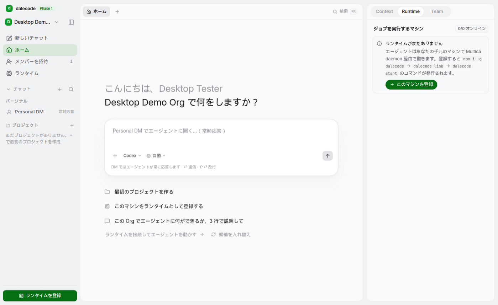

# dalecode Desktop（macOS シェル）

dalecode の Web アプリ（https://team-harness.gawara.workers.dev）を包む **Electron** 製のデスクトップシェル。
UI は一切バンドルせず、デプロイ済みの Web をそのまま読み込む（既定は production。環境変数で staging / local に切替）。
シェル側が持つのは「ハード化した BrowserWindow」「ナビゲーションの境界」「Google OAuth をシステムブラウザで回して
`dalecode://` で戻す仕組み」の 3 点だけ。



## Mac でビルドして動かす（Apple Silicon）

前提: macOS 12+、Node 22+、npm、Xcode Command Line Tools（`xcode-select --install`。dmg 作成に `hdiutil` を使う）。

```bash
# リポジトリのルートで
npm run desktop:install      # apps/desktop の依存（Electron 本体を含む）をインストール

# 開発起動（production の Web を読み込む）
npm run desktop:dev

# .app（未署名、release/mac-arm64/dalecode.app）— Google ログインの deep link 検証はこちらで
npm run desktop:pack

# 配布物: release/dalecode-0.1.0-mac-arm64.dmg / .zip
npm run desktop:build
open apps/desktop/release/dalecode-0.1.0-mac-arm64.dmg
```

`apps/desktop` 内で直接叩く場合: `npm run dev` / `npm run pack` / `npm run dist:mac`（arm64）/
`npm run dist:mac:universal`（arm64 + x64 の Universal）/ `npm run dist:mac:intel`。

未署名の .app なので、初回は Finder で **右クリック → 開く**（または `xattr -dr com.apple.quarantine <path>.app`）。
自分の Mac でビルドした .app には quarantine 属性が付かないため、そのまま開ける。Apple Silicon 向けには
electron-builder が ad-hoc 署名を自動で施す。

### 接続先の切替

| 方法 | 例 |
|---|---|
| メニュー **Server**（設定は `~/Library/Application Support/dalecode/settings.json` に保存） | Production / Staging / Local |
| `DALECODE_DESKTOP_ENV` | `DALECODE_DESKTOP_ENV=staging npm run desktop:dev`（`npm run dev:staging` / `dev:local` も同じ） |
| `DALECODE_DESKTOP_URL` または `--url=` | `DALECODE_DESKTOP_URL=https://team-harness-pr-12.gawara.workers.dev npm run desktop:dev` |

`local` は `http://127.0.0.1:43173`（`npm run dev` の Vite）。Vite / Convex / files Worker はどれも loopback なので同一オリジン扱い。

その他の環境変数: `DALECODE_DESKTOP_DEVTOOLS=1`（起動時に DevTools を開く）、
`DALECODE_DESKTOP_OAUTH=in-app`（後述、開発用）、`DALECODE_DESKTOP_SMOKE=<png>`（CI 用のスクリーンショット即終了モード）。

## Electron を選んだ理由（vs Tauri）

| 観点 | Electron（採用） | Tauri |
|---|---|---|
| レンダリング | Chromium 同梱。Web アプリは Chromium 系で検証済みなので**見え方が完全に一致**（Beautiful UI の `oklch` / `color-mix` / backdrop など） | macOS は WKWebView（Safari 系）。CSS/JS の差分検証が別途必要、DevTools も限定的 |
| OAuth / deep link | `open-url` + `setAsDefaultProtocolClient` + `will-navigate` で完結。実績が多い | plugin-deep-link + plugin-opener で可能だが Rust 側の配線が必要 |
| ツールチェーン | Node + npm のみ。既存の TS/ESLint/Vitest にそのまま乗る。**Linux CI でも起動・スクショが撮れる**（xvfb） | Rust toolchain + `cargo`、Linux では webkit2gtk 一式。この VM では Mac バイナリも Linux 検証も重くなる |
| セキュリティ既定 | `contextIsolation` + `sandbox` + preload 経由の最小ブリッジで、Web 側は `window.dalecodeDesktop` しか見えない | IPC allowlist（capabilities）。同等の隔離は可能 |
| 配布サイズ | ~200 MB（Chromium 込み） | ~10 MB |
| 署名 / 公証 | electron-builder に `notarize` 内蔵 | tauri-bundler でも可能 |

判断: このシェルは**「Web アプリを 1 枚のウィンドウに載せて OAuth と deep link を正しく扱う」**ことだけが仕事で、
Rust で書くネイティブ機能がない。Chromium との描画一致と、Linux CI で実機相当の起動確認（本 PR のスクリーンショットは
すべて Ubuntu の xvfb 上で撮影）ができる点を優先し、サイズの不利は許容した。
将来、ネイティブ機能（メニューバー常駐、ローカル CLI の直接起動など）が増えても Electron の main プロセスで足りる想定。

## アーキテクチャ

```
apps/desktop/
├── src/main/index.ts      # app ライフサイクル、BrowserWindow、ナビゲーション境界、deep link、smoke モード
├── src/main/config.ts     # 接続先の解決（--url / env / settings.json / production）
├── src/main/deepLink.ts   # dalecode://auth/callback → /login?code=… の変換
├── src/main/menu.ts       # macOS メニュー（Edit/View/Server/Window/Help）
├── src/main/fallback.ts   # オフライン時の data: URL ページ（再接続ボタン）
├── src/preload/index.ts   # contextBridge → window.dalecodeDesktop（version / platform / oauthRedirectTo）
├── build.mjs              # esbuild: main.cjs / preload.cjs（sandbox preload は CJS 必須）
├── electron-builder.yml   # appId, protocols(dalecode), mac dmg/zip, entitlements, identity: null
├── build/                 # icon.png（scripts/make-icon.mjs が生成）, entitlements.mac.plist
└── scripts/smoke.mjs      # 起動 → 描画 → PNG 保存 → 終了（CI / VM 用）
```

Web 側の変更（同じ PR）:

- `src/lib/desktop.ts` — ブリッジの型と `oauthRedirectTo(next)` ヘルパ。ブラウザでは undefined → 従来動作。
- `src/pages/LoginPage.tsx` — 「Google で続ける」が `redirectTo` にシェル用アドレスを渡す。待機中のラベルとキャンセル。
- `convex/lib/authRedirect.ts` + `convex/auth.ts` — Convex Auth の `callbacks.redirect` で `dalecode://auth/callback` を**厳密一致**で許可
  （それ以外は既定ルール = 相対パス / `SITE_URL` のまま。`tests/authRedirect.test.ts`）。

### セキュリティ境界

- `contextIsolation: true` / `nodeIntegration: false` / `sandbox: true`。preload は `contextBridge` で読み取り専用の 4 プロパティだけ公開。
- `will-navigate` / `will-redirect` / `setWindowOpenHandler`: **アプリのオリジン以外へは一切遷移しない**。http(s) は `shell.openExternal`（システムブラウザ）、それ以外はブロック。
- `setPermissionRequestHandler`: notifications / clipboard / fullscreen 以外の権限要求は拒否。
- 単一インスタンス（`requestSingleInstanceLock`）。2 つ目の起動は deep link を既存ウィンドウへ転送。

## 認証の設計（パスワード + Google OAuth）

**パスワード**: Web と完全に同じ。Convex Auth のトークンはレンダラの `localStorage`（Electron が
`~/Library/Application Support/dalecode/` に永続化）に入るので、再起動後もログイン状態が保たれる。

**Google OAuth はシステムブラウザで行う（採用）**。理由:

1. Google は埋め込み WebView / Electron UA からのサインインを「安全でないブラウザ」として拒否することがある（policy: *Use secure browsers*）。
2. ユーザーは普段のブラウザで Google にログイン済みのことが多く、パスキーや 2 段階認証もそこで動く。
3. シェル内で Google のクッキーを持たないので、Chromium セッションに Google 資格情報を溜めない。

フロー（Convex Auth の PKCE 風 verifier をそのまま利用）:

```
Electron ウィンドウ (/login)                     システムブラウザ                         Convex (.convex.site)
─────────────────────────                        ─────────────────                        ─────────────────────
signIn("google", { redirectTo: "dalecode://auth/callback?next=…" })
  → auth:signIn が redirect URL + verifier を返す
  → verifier を localStorage に保存
  → window.location = https://<dep>.convex.site/api/auth/signin/google?…
main: will-navigate で外部と判定 → preventDefault
  → shell.openExternal(そのURL) ──────────────▶ Google 同意画面 ──────────▶ /api/auth/callback/google
                                                                             ← callbacks.redirect が
                                                                               dalecode://auth/callback を許可
                                            ◀── 302 dalecode://auth/callback?next=…&code=<one-time>
macOS: open-url → main.handleDeepLink
  → win.loadURL(https://<app>/login?next=…&code=<one-time>)
ConvexAuthProvider が URL の code と localStorage の verifier で auth:signIn → トークン取得 → next へ遷移
```

ポイント: **code の交換は Electron ウィンドウの中で行う**（verifier がそこにしかない）。ブラウザ側は `dalecode://` に
リダイレクトされた時点で役目を終える。`next`（招待リンク等）は deep link のクエリで往復するので、Web と同じく `?next=` が維持される。

### 開発時の注意（macOS で deep link を試す）

`electron .`（未パッケージ）の実行ファイルは Electron.app なので、`Info.plist` に `dalecode` スキームがなく `open-url` が届かない。
Google ログインまで確認したいときは:

- `npm run desktop:pack` で `release/mac-arm64/dalecode.app` を作って起動する（`protocols` が Info.plist に入る）、または
- `DALECODE_DESKTOP_OAUTH=in-app npm run desktop:dev` — **開発専用**のフォールバック。Google をウィンドウ内で開き、
  UA から `Electron/…` を除いて `redirectTo` を Web と同じ `/login` に戻す。Google の policy 上グレーなので配布物では使わない。

production / staging の Convex に `callbacks.redirect` が入っていない間は、ブラウザ側で
`Invalid redirectTo dalecode://auth/callback` になる（= この PR の Convex 側変更が対象デプロイに反映されてから有効）。
Google Cloud Console 側の **Authorized redirect URIs は変更不要**（コールバック先は今までどおり `https://<deployment>.convex.site/api/auth/callback/google`）。

## Linux / CI（この VM で確認した範囲）

`.github/workflows/desktop.yml`:

- `linux-check`（PR / push で `apps/desktop/**` が変わったとき）: `npm ci` → typecheck → esbuild → **xvfb 上で 3 回起動**
  （production 読み込み / `dalecode://` 疑似コールバック / オフラインフォールバック）→ スクリーンショットを artifact に →
  `electron-builder --linux dir` で packaging 設定を検証。
- `mac-dmg`（`workflow_dispatch` または `desktop-v*` タグ）: `macos-latest` で **未署名** の arm64 `.dmg` / `.zip` を artifact に。

ローカルの同等コマンド: `npm run desktop:smoke -- /tmp/shell.png`（`DISPLAY` がなければ `xvfb-run` を自動使用）。

Linux でできなかったこと: `.dmg` / `.app` の生成（`hdiutil` と macOS 固有のバンドル処理が必要）。
上の「Mac でビルドして動かす」か、`mac-dmg` ジョブを手動実行してください。

## フォローアップ: 署名と公証（Developer ID）

1. Apple Developer Program の **Developer ID Application** 証明書をビルドマシンのキーチェーンに入れる（CI なら `CSC_LINK` / `CSC_KEY_PASSWORD` に .p12）。
2. `electron-builder.yml` の `mac.identity: null` を削除し、`mac.notarize: true` を追加。
3. 環境変数 `APPLE_ID` / `APPLE_APP_SPECIFIC_PASSWORD` / `APPLE_TEAM_ID` を設定して `npm run dist:mac`。electron-builder が署名 → 公証 → staple まで行う。
4. `hardenedRuntime: true` と `build/entitlements.mac.plist`（JIT / unsigned-executable-memory / network.client）は既に公証要件に合わせてある。
5. 自動更新を入れる場合は `electron-updater` + `publish`（GitHub Releases など）を追加。現在は `publish: null`。

## その他の既知事項

- ウィンドウの位置・サイズと Server の選択は `settings.json` に保存。macOS では赤ボタンで閉じると Dock に残る（⌘Q で終了）。
- 外部リンク（チャット内 Markdown の `target=_blank` など）はすべてシステムブラウザで開く。
- タイトルバーは標準（`hiddenInset` は Web 側サイドバーと traffic light の位置調整が必要になるため見送り）。
- アイコンは `scripts/make-icon.mjs` が生成する 1024px PNG（electron-builder が .icns に変換）。差し替えは `build/icon.png` を上書き。
